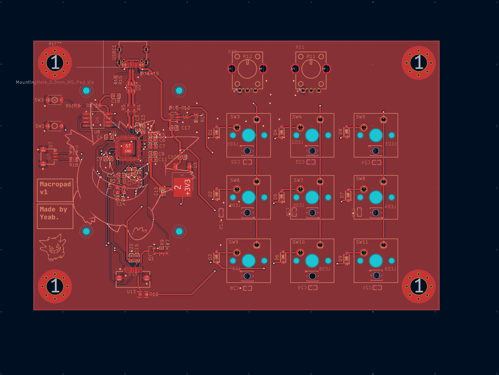
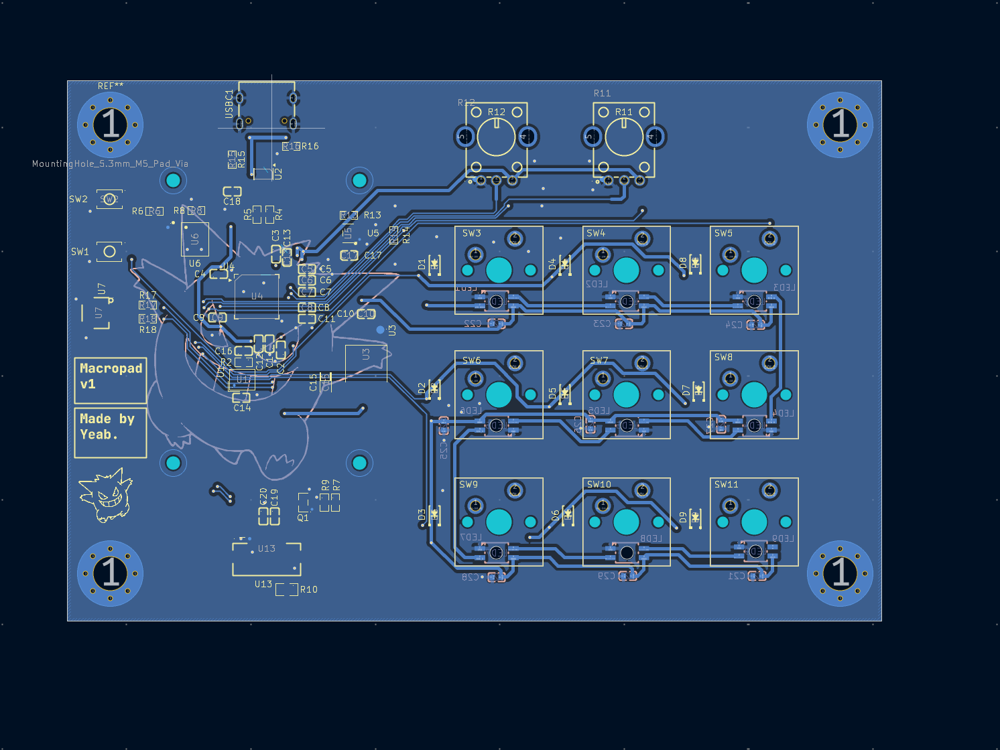

# RP2040 9-Key Macropad

A custom 9-key programmable macropad designed around the Raspberry Pi RP2040.

The project is currently focused on hardware development. Firmware development
has not yet begun.

## Features

- Raspberry Pi RP2040 microcontroller
- 3×3 mechanical keyboard matrix
- Per-key diode isolation
- Per-key WS2812 RGB backlighting
- Two analog rotary potentiometers
- 2.0-inch SPI TFT display
- USB-C connectivity and power
- External QSPI flash
- BOOTSEL and hardware reset controls
- SWD debugging interface
- USB ESD protection
- 3.3 V onboard regulation

## Project Status

**Hardware:** In development  
**PCB Revision:** v0.1  
**Firmware:** Not started  
**Manufacturing:** Not yet validated

> This is an in-development hardware design and has not yet been validated
> through production assembly or full hardware bring-up.

## Hardware

Designed in KiCad 10.

### System Architecture

USB-C
→ USB protection
→ RP2040

RP2040 interfaces with:
- 3×3 keyboard matrix
- WS2812 RGB LED chain
- SPI TFT display
- 2× analog potentiometers
- external QSPI flash
- SWD debug interface

## PCB

### Top

### Bottom

### 3D Renders

## Firmware

Firmware has not yet been implemented.

Planned functionality includes:

- USB HID keyboard support
- programmable key mappings
- RGB lighting effects
- volume control
- configurable secondary analog control
- display UI
- persistent configuration

Potential firmware platforms include the Pico SDK and QMK.

## Roadmap

- [x] System architecture
- [x] RP2040 schematic
- [x] Keyboard matrix
- [x] RGB backlighting circuitry
- [x] USB-C interface
- [x] TFT interface
- [x] SWD debugging interface
- [x] PCB layout
- [x] Design-rule review
- [ ] Prototype fabrication
- [ ] Hardware bring-up
- [ ] Firmware development
- [ ] Enclosure design
